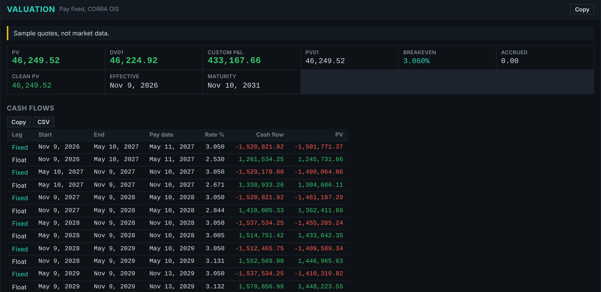
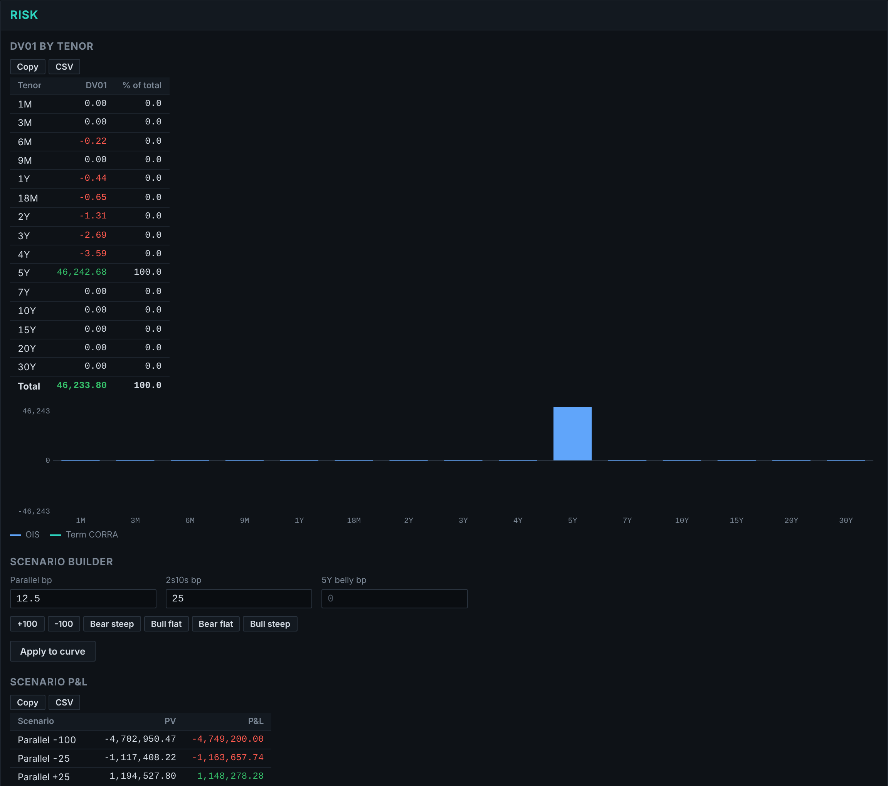

# CORRA Swap Pricer

Price Canadian interest rate swaps and measure their risk, in the browser or in Excel.

**Live tool:** https://khanhas3.github.io/CORRA-Model/

## What it does

- Bootstraps a CORRA OIS discount curve from par swap rates
- Prices fixed vs CORRA OIS and fixed vs Term CORRA swaps (dual curve)
- PV, DV01, PV01, gamma and breakeven rate
- DV01 by tenor (key-rate risk)
- Scenario P&L: parallel shifts, steepeners, flatteners and custom curve shapes
- Exact cash flow dates on the Toronto calendar
- Export to Excel, or copy any table straight into a spreadsheet
- Live CORRA and policy rate from the Bank of Canada

## Conventions

| | |
|---|---|
| Day count | ACT/365 Fixed |
| Calendar | Toronto, Modified Following |
| CORRA OIS | Trade-date start, semi-annual, daily compounded in arrears, 1 business day payment lag |
| Term CORRA | T+2 start, semi-annual, flat compounding, projected on its own curve, discounted on OIS |
| Interpolation | Log-linear on discount factors |
| DV01 | PV with all par quotes +1bp, curve rebuilt, minus base PV |

## Excel model

`CORRA_Swap_Model.xlsx` is the same idea built entirely from formulas, so every step can be audited. Enter quotes on the **Inputs** sheet and read results on **Summary**. It uses a closed-form semi-annual bootstrap and agrees with the web tool to within a fraction of a basis point.

## Validation

- Par swaps reprice to zero on both single and dual curves
- Realised CORRA compounding and discount factors match an independent Python calculation
- Excel results match an independent recalculation exactly

## Data

CORRA fixings come from the [Bank of Canada Valet API](https://www.bankofcanada.ca/valet/docs). OIS and Term CORRA swap quotes are not published freely, so enter them from Bloomberg, Refinitiv or a dealer. The built-in example uses illustrative rates, not market data.

## Run locally

Open `index.html` in any browser. No install or build step.
